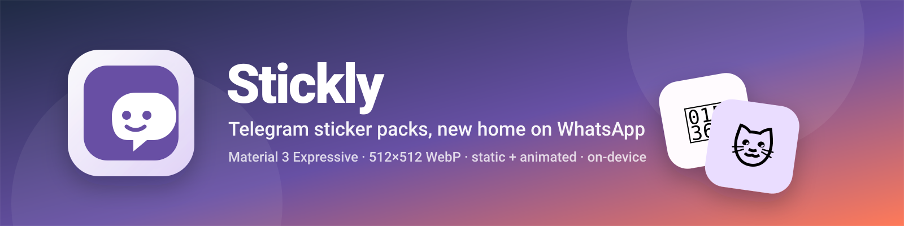

<a id="stickly"></a>

<p align="center">
  
</p>

<p align="center">
  
</p>

<p align="center">
  <a href="https://github.com/popeye0013/Stickly/releases/latest">
    
  </a>
  <a href="https://github.com/popeye0013/Stickly/releases">
    
  </a>
  <a href="https://github.com/popeye0013/Stickly/stargazers">
    
  </a>
  <a href="LICENSE">
    
  </a>
  
</p>

<p align="center">
  <a href="https://github.com/popeye0013/Stickly/releases/latest">
    
  </a>
  <a href="Stickly-v1.0.apk">
    
  </a>
</p>

<p align="center">
  <a href="#download">Download</a> ·
  <a href="#how-it-works">How it works</a> ·
  <a href="#features">Features</a> ·
  <a href="#format-rules">Format rules</a> ·
  <a href="#build-from-source">Build</a> ·
  <a href="#tech-stack">Stack</a> ·
  <a href="#faq">FAQ</a>
</p>

---

## &nbsp;Features

### &nbsp;Import

- **Every sticker is imported.** No skips, no placeholders unless a source truly cannot be decoded.
- **Content-aware conversion.** Downloads are detected from their bytes as PNG/WebP, gzipped `TGS`, or WebM, instead of trusting Telegram's metadata.
- **Balanced splits.** Packs larger than 30 stickers become evenly sized WhatsApp packs named `Your Name (1/4)` … `(4/4)`.
- **Fast parallel prep.** Downloads and conversions run concurrently with bounded parallelism.
- **Your name only.** Stickly asks for a pack name; WhatsApp always shows **Stickly** as the publisher.

### &nbsp;Export

- **WhatsApp-ready WebP.** Static stickers are 512×512 WebP under 100 KB; animated stickers are real animated WebP under 500 KB.
- **Real animation.** `TGS` and video stickers keep their motion; static stickers in an animated pack are converted so packs never mix formats.
- **Valid frame timing.** Every animated frame is longer than 8 ms and the total stays under 10 seconds.
- **Provider flag set.** Animated packs advertise `animated_sticker_pack=1` to WhatsApp.
- **Added badge.** After WhatsApp confirms the pack, **Add to WhatsApp** is replaced by an **Added to WhatsApp** badge.
- **ZIP export.** Save the whole pack to any location using the Android file picker.

### &nbsp;Design &amp; details

- **Material 3 Expressive** — expressive shapes, buttons, loading indicators and `MotionScheme.expressive()`.
- **Themes** — System / Light / Dark, plus optional Material You dynamic colours (off by default).
- **Google Sans Flex** — used at weights 400–900 throughout the app.
- **In-app hints** — dismissible hints that disappear after 3 seconds; no toasts or snackbars.
- **Animated welcome** — a friendly first-launch screen with no tutorial steps.
- **Local profile** — your name stays on this device.

---

## &nbsp;How it works

1. **Settings → Telegram bot token.** Telegram's Bot API is the only reliable public way to read a sticker set. A **Guide** button below Save token opens a popup showing how to create a bot with [@BotFather](https://t.me/BotFather). The token stays on your device and is only sent to `api.telegram.org`.
2. **Home → paste a pack link**, for example `t.me/addstickers/DonutTheDog`, then tap **Import pack**. You can also share a `t.me/addstickers/...` link from another app. The URL field clears after a successful import.
3. **Stickly converts everything.** PNG/WebP are re-encoded as static WebP; `TGS` and WebM are converted to animated WebP. If any sticker animates, the whole pack is exported as animated WebP. Generated files are checked before they reach WhatsApp.
4. **Open a pack.** Tap any sticker to view it full screen, or long-press stickers to select up to 25 and create a custom WhatsApp pack. Long-press a pack on Home to delete it.
5. **Add to WhatsApp.** Stickly prepares/repairs the pack, opens WhatsApp's preview, and shows an **Added to WhatsApp** badge once confirmed.

---

## &nbsp;Format rules

WhatsApp's sticker contract is strict. Stickly applies these rules automatically:

| Rule | What Stickly does |
|---|---|
| Dimensions | Every sticker is rendered on a transparent 512×512 canvas. |
| Static size | Re-encoded as WebP up to 100 KB, with quality and scaling fallbacks. |
| Animated size | Real animated WebP up to 500 KB, with quality/frame sampling fallbacks. |
| Frame timing | More than 8 ms per frame and no more than 10 seconds total. |
| Tray icon | 96×96 PNG up to 50 KB. |
| Pack size | 3–30 stickers per pack; larger sets are split evenly. |
| No mixing | If one sticker animates, every sticker in that pack becomes animated. |
| Emojis | Telegram emojis are mapped to WhatsApp's supported list; a default is supplied when missing. |
| Identifiers | Pack IDs stay under WhatsApp's 128-character limit. |

---

## &nbsp;Download

The signed release APK is committed in this repository as [`Stickly-v1.0.apk`](Stickly-v1.0.apk) and attached to the [latest GitHub release](https://github.com/popeye0013/Stickly/releases/latest).

```text
Stickly-v1.0.apk
SHA-256: 01ce672fbd4130eab369f0d4a1957839a3cd49263729920bf60652d47359659b
```

Install it directly on Android 8.0 or newer. The app is signed with a release key so it can be installed without a separate debug build.

---

## &nbsp;Build from source

**Requirements:** JDK 17 and Android SDK 36.

```bash
git clone https://github.com/popeye0013/Stickly.git
cd Stickly
./gradlew assembleRelease
```

The signed APK is written to:

```text
app/build/outputs/apk/release/app-release.apk
```

For a debug build:

```bash
./gradlew assembleDebug
```

`local.properties` must point `sdk.dir` at an Android SDK with platform 36 installed.

---

## &nbsp;Tech stack

| Layer | Technology |
|---|---|
| Language | Kotlin 2.4 |
| UI | Jetpack Compose, Material 3 Expressive `1.5.0-alpha13` |
| Networking | OkHttp, Telegram Bot API |
| Stickers | `webp-android` / native libwebp, Lottie `TGS`, Coil 3 |
| WhatsApp | Official sticker content provider contract |
| Storage | SharedPreferences + on-device sticker files |
| Images | Android `ImageDecoder`, `BitmapFactory`, custom WebP encoding |
| Build | AGP 8.13.2, Gradle 8.13 |

### &nbsp;Project layout

```text
app/src/main/java/com/stickly/app/
├── data/        # Models, repository, preferences and theming state
├── telegram/    # Bot API client, file download and pack parsing
├── util/        # WebP, animated WebP, TGS/video and tray conversion
├── whatsapp/    # Content provider and add-pack intent
└── ui/          # Compose screens, components, dialogs and theme
```

---

## &nbsp;FAQ

<details>
<summary><strong>Do I need a Telegram bot token?</strong></summary>

Yes. Telegram has no public unauthenticated endpoint for reading sticker sets. Create a free bot with [@BotFather](https://t.me/BotFather), paste the token into Settings, and Stickly will only send it to `api.telegram.org`. The token is stored on your device.

</details>

<details>
<summary><strong>Why does one imported pack become several packs?</strong></summary>

WhatsApp allows 3–30 stickers per pack. Stickly splits larger Telegram sets into balanced packs and names them `Your Name (1/4)`, `(2/4)`, and so on.

</details>

<details>
<summary><strong>Can I mix static and animated stickers?</strong></summary>

No. WhatsApp rejects mixed packs. If any sticker is animated, Stickly converts every sticker in that pack to animated WebP and sets the animated pack flag.

</details>

<details>
<summary><strong>Why does an animated sticker show as an emoji sometimes?</strong></summary>

If a source frame cannot be decoded, Stickly uses an emoji placeholder so the sticker is never dropped and the pack stays importable.

</details>

<details>
<summary><strong>Is anything uploaded?</strong></summary>

No analytics or tracking SDKs. Only the Telegram Bot API calls needed to read the pack and download its files leave your device. Stickers, tokens and preferences stay local.

</details>

<details>
<summary><strong>Is Stickly affiliated with Telegram or WhatsApp?</strong></summary>

No. Stickly is an independent, unofficial project. All trademarks and sticker content belong to their respective owners. Only import packs you have the right to reuse.

</details>

---

## &nbsp;Contributing

Issues and pull requests are welcome.

- Keep changes focused and match the existing Kotlin / Compose style.
- Run `./gradlew assembleRelease` before opening a PR.
- For a bug report, include your Android version, Stickly version, pack link and steps to reproduce.

---

## &nbsp;Legal disclaimer

Stickly is an **unofficial, independent project**. It is not affiliated with, endorsed by, or sponsored by Telegram, WhatsApp or Meta. All trademarks, logos and sticker content belong to their respective owners.
